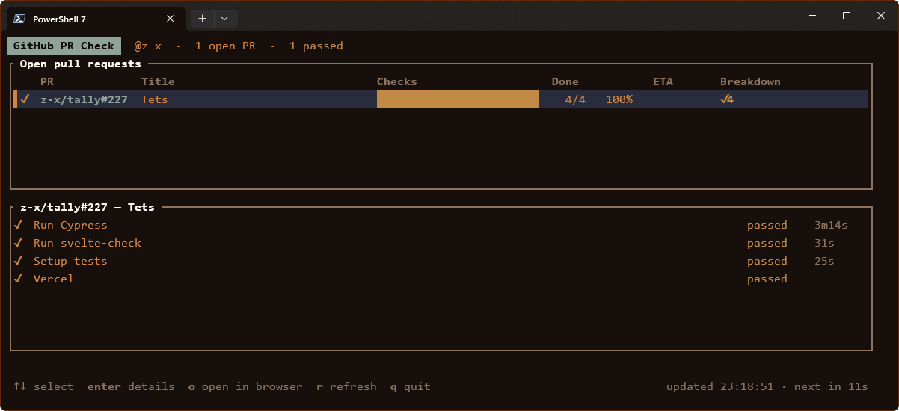

# GitHub PR Check

A terminal dashboard showing the CI status of **your open GitHub pull requests**, refreshed automatically.




For every open PR you authored, in any repo or organization your token can see, it shows:

- the overall CI state (✓ passed, ✗ failing, spinner while running, – no checks)
- a progress bar split into passed / failed / skipped / running / queued
- how many checks have finished, out of how many, and the percentage
- for running GitHub Actions jobs: the current step, plus an **estimated % and time left**, based on how long the same job took in recent successful runs
- a details pane listing every check of the selected PR, failures first, with durations

PRs in archived repositories are hidden.

## 1. Get a GitHub personal access token (PAT)

### Recommended: classic token

A classic token works with every repo you have access to, including organization repos.

1. Go to **https://github.com/settings/tokens/new**.
   (That's Settings → Developer settings → Personal access tokens → **Tokens (classic)** → *Generate new token (classic)*.)
2. **Note:** e.g. `github-pr-check`.
3. **Expiration:** pick one (e.g. 90 days).
4. **Scopes:** tick **`repo`**. Nothing else is needed.
   If you only work on public repos, `public_repo` is enough.
5. Click **Generate token** and copy it (`ghp_…`). GitHub shows it only once.
6. **Organizations with SAML single sign-on:** on the token list, click **Configure SSO** next to the token and **Authorize** each organization. Otherwise PRs from that org won't appear, and github-pr-check shows a warning in the footer.

> Some organizations block classic tokens altogether (org setting *"Restrict access via personal access tokens (classic)"*). If an org's PRs still don't show up, ask an org admin.

### Alternative: fine-grained token

Fine-grained tokens work too, with two limitations:

- A fine-grained token is tied to **one owner**: your personal account *or* one organization. PRs elsewhere won't show up.
- Fine-grained tokens **can't be granted the "Checks" permission** (GitHub reserves it for GitHub Apps). The counts and progress bar stay accurate. github-pr-check gets check names and step progress from the GitHub Actions API instead, so checks from **third-party apps** (non-Actions check runs) appear in the counts but not by name.

Create one at **https://github.com/settings/personal-access-tokens/new** with these **repository permissions**:

| Permission      | Access    |
|-----------------|-----------|
| Pull requests   | Read-only |
| Commit statuses | Read-only |
| Actions         | Read-only |
| Metadata        | Read-only (added automatically) |

## 2. Put the token where github-pr-check can find it

github-pr-check checks these variables, in order: **`GITHUB_PAT`**, `GITHUB_TOKEN`, `GH_TOKEN`.

**Option A: a `.env` file**, either **next to the github-pr-check binary** or in the directory you run it from:

```
GITHUB_PAT=ghp_yourTokenHere
```

If both exist, the one in the current directory wins. Real environment variables take precedence over any `.env`. If no token is found, the error message lists every path that was checked. `.env` is in `.gitignore`, so it won't be committed.

**Option B: an environment variable.** This is better if you install github-pr-check globally and run it from anywhere.

PowerShell, for the current session:
```powershell
$env:GITHUB_PAT = "ghp_yourTokenHere"
```

Windows, permanently for your user (open a new terminal afterwards):
```powershell
setx GITHUB_PAT "ghp_yourTokenHere"
```

macOS / Linux (add it to `~/.bashrc`, `~/.zshrc`, …):
```sh
export GITHUB_PAT=ghp_yourTokenHere
```

## 3. Install

### Download a prebuilt binary

Grab the archive for your platform from the repository's **Releases** page:

| Platform              | File                                              |
|-----------------------|---------------------------------------------------|
| Windows (x64)         | `github-pr-check-<version>-x86_64-pc-windows-msvc.zip`  |
| Linux (x64)           | `github-pr-check-<version>-x86_64-unknown-linux-musl.tar.gz` |
| Linux (ARM64)         | `github-pr-check-<version>-aarch64-unknown-linux-musl.tar.gz` |
| macOS (Apple Silicon) | `github-pr-check-<version>-aarch64-apple-darwin.tar.gz` |
| macOS (Intel)         | `github-pr-check-<version>-x86_64-apple-darwin.tar.gz`  |

Unpack it and put `github-pr-check` (`github-pr-check.exe` on Windows) somewhere on your `PATH`. The Linux binaries are fully static and work on any distribution. `SHA256SUMS.txt` lists checksums for verifying the downloads.

- **Linux / macOS:** if needed, make it executable with `chmod +x github-pr-check`.

#### macOS: allowing the app to run

The binary isn't signed or notarized by Apple, so the first launch of a downloaded copy is blocked with a message like *"github-pr-check" Not Opened* or *Apple could not verify "github-pr-check" is free of malware*. Click **Done** (not *Move to Trash*), then allow it once:

1. Open **System Settings → Privacy & Security**.
2. Scroll down to the **Security** section. It shows *"github-pr-check" was blocked to protect your Mac.*
3. Click **Open Anyway** and confirm with your password or Touch ID.
4. Run the app again and click **Open Anyway** in the dialog that follows.

After that, macOS remembers the choice for this copy. Repeat these steps after downloading a new version.

The **Open Anyway** button only appears for about an hour after the blocked launch. If it isn't there, run the app again first.

**Alternative (Terminal):** remove the quarantine flag that macOS adds to downloaded files, and the app runs without any prompt:
```sh
xattr -d com.apple.quarantine ./github-pr-check
```

### Or build from source

You need Rust (stable). Install it from **https://rustup.rs**.

- **Windows:** you also need the *Visual Studio C++ Build Tools* (the "Desktop development with C++" workload). rustup offers to install them, or run:
  ```powershell
  winget install Microsoft.VisualStudio.2022.BuildTools --override "--passive --wait --add Microsoft.VisualStudio.Workload.VCTools --includeRecommended"
  ```
- **Linux / macOS:** a C compiler (`build-essential` / Xcode Command Line Tools). OpenSSL isn't needed: TLS is built in.

Run it from the project directory:

```sh
cargo run --release
```

Or install it as a command you can run from anywhere. `cargo install` puts the binary in `~/.cargo/bin`, so either put `.env` there or use option B:

```sh
cargo install --path .
github-pr-check
```

### Options

| Option                     | Description                                                    |
|----------------------------|----------------------------------------------------------------|
| `-i`, `--interval <secs>`  | Auto-refresh interval in seconds (default `15`, minimum `5`)   |
| `--once`                   | Print a plain-text snapshot and exit, without the interactive view. Useful for scripts or for checking a token. |
| `-V`, `--version`          | Show version                                                   |
| `-h`, `--help`             | Show help                                                      |

```sh
cargo run --release -- --interval 30
cargo run --release -- --once
```

### Keys

| Key              | Action                          |
|------------------|---------------------------------|
| `↑` `↓` / `k` `j` | Select PR                      |
| `Home` `End` / `g` `G` | First / last PR           |
| `Enter` / `d`    | Toggle the details pane         |
| `o`              | Open the selected PR in the browser |
| `r`              | Refresh now                     |
| `q` / `Esc` / `Ctrl+C` | Quit                      |

## Releasing

`.github/workflows/release.yml` builds every platform on GitHub Actions. To publish a release:

1. Bump `version` in `Cargo.toml` and commit.
2. Tag and push:
   ```sh
   git tag v0.2.0
   git push origin v0.2.0
   ```

The workflow builds all five targets and creates a GitHub Release with the archives and `SHA256SUMS.txt`. To build without publishing, run the workflow manually from the Actions tab; the binaries then appear as artifacts of that run.

### Publishing to winget

Once set up, every release tag (except pre-releases like `v0.2.0-rc1`) also opens a pull request on [microsoft/winget-pkgs](https://github.com/microsoft/winget-pkgs) updating the `z-x.GitHubPRCheck` package. A winget moderator merges it, usually within a few days.

One-time setup:

1. **Fork** https://github.com/microsoft/winget-pkgs to your account. The workflow pushes its branches there.
2. **Submit the first version by hand**, since the automation can only update an existing package. Take the Windows zip URL of a release made by this workflow:
   ```powershell
   winget install wingetcreate
   wingetcreate new https://github.com/z-x/github-pr-check/releases/download/v0.2.0/github-pr-check-v0.2.0-x86_64-pc-windows-msvc.zip
   ```
   Use `z-x.GitHubPRCheck` as the package identifier, and `github-pr-check` as the portable command alias. When it asks, let it submit the PR. Wait for it to be merged.
3. **Create a classic token** with the `public_repo` scope (https://github.com/settings/tokens/new) and add it as a repository secret named `WINGET_TOKEN` (Settings → Secrets and variables → Actions).

Until the secret exists, the *Submit to winget* job is skipped.

## How the estimates work

For each running GitHub Actions job, github-pr-check looks up the last 5 successful runs of the same workflow and takes the **median duration of the job with the same name**. Elapsed time against that median gives the `~62% · 1m10s left` shown in the details pane. The **ETA** column shows when the slowest running job of the PR should finish.

- These are time-based estimates, not real test counts.
- Jobs that are still queued aren't included in the ETA.
- A job with no successful runs yet shows no estimate.
- A job that runs past its usual duration shows `… longer than usual` (`overdue` in the ETA column).
- Job history is cached for 30 minutes, and finished runs are never fetched again, so the extra API usage is small.

## Troubleshooting

| Symptom | Fix |
|---|---|
| `401 Unauthorized` | The token is wrong or expired. Generate a new one. |
| An organization's PRs are missing | Authorize the token for SSO (step 1.6). The org may also restrict classic tokens. With a fine-grained token, only one owner's repos are visible. |
| ⚠ warning in the footer | Non-fatal problems such as SSO or permissions. The rest of the data is still shown. |
| Check names missing, counts fine | Fine-grained token without `Actions: Read-only`, or the checks come from a third-party app. Use a classic token. |
| `failed to remove file … github-pr-check.exe (Access is denied)` while rebuilding on Windows | github-pr-check is still running. Quit it (`q`) and rebuild. |
| Odd symbols instead of ✓ ✗ ⠹ █ | Use a terminal font with good Unicode coverage (e.g. Cascadia Code, JetBrains Mono). |
| Dim text hard to read | github-pr-check uses your terminal's *bright black* colour for secondary text. Make it lighter in your terminal's colour scheme. |

GitHub's API rate limits are not a concern at the default interval: one GraphQL request per refresh, plus a few REST calls only while CI is running.
